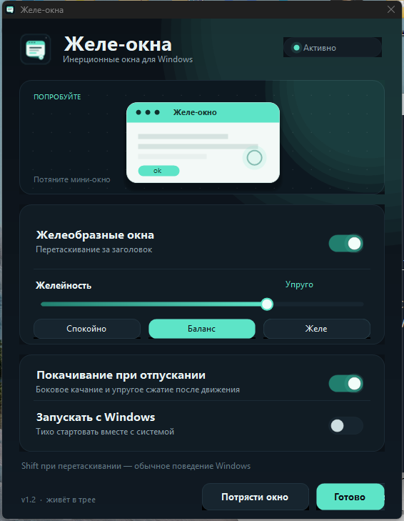

# Окна

Инерционные окна для Windows: при перетаскивании за заголовок окно отстаёт,
изгибается по инерции и мягко догоняет курсор. Содержимое остаётся живым —
видео играет, проводник обновляется, браузер рисует страницу.



## Что умеет

- **Изгиб по инерции.** Края окна изгибаются при разгоне и торможении, как
  будто окно сделано из железа. Без пружин и раскачки — только честная
  деформация от ускорения.
- **Живое содержимое.** Копия окна обновляется 30–60 раз в секунду, поэтому
  видео, анимации и списки файлов не замирают во время перетаскивания.
- **Покачивание при отпускании** (по желанию): короткое боковое качание после
  остановки.
- **Желейное покачивание.** Окно колышется, когда разворачивается на весь
  экран, когда снова становится обычным и когда возвращается из панели задач:
  копия окна изгибается и оседает, как желе, а не дёргается целиком.
- **Разбивание при закрытии.** Когда окно закрывают кнопкой (или по Alt+F4),
  оно рассыпается на осколки, которые разлетаются от кнопки закрытия,
  кувыркаются, падают и тают.
- **Shift** при перетаскивании — обычное поведение Windows, включая Aero Snap.
- **Трей.** Программа живёт в трее и не мешает: левый клик — настройки,
  правый — меню.
- **Автозапуск** вместе с Windows.
- **Автообновление** из GitHub Releases.

## Установка

1. Скачайте `Okna.exe` со страницы [Releases](../../releases/latest).
2. Положите в любую папку и запустите.
3. Окно настроек появится при первом запуске. Дальше программа живёт в трее.

Папку лучше выбрать ту, куда у вас есть права записи (рабочий стол, документы,
`%LOCALAPPDATA%`). В `Program Files` автообновление не сможет заменить файл.

Требования: Windows 8.1, 10 или 11 (64-бит), .NET Framework 4.8. В Windows 10
и 11 он уже установлен; на 8.1 его нужно поставить один раз. В Windows 8.1 и в
Windows 10 до версии 1803 нет Windows Graphics Capture, поэтому проводник при
перетаскивании показывает замороженную копию содержимого — остальные эффекты
работают полностью. Права администратора не нужны.

Программа раньше называлась «Желе-окна». При первом запуске настройки
переносятся автоматически, старую версию можно удалить.

## Настройки

| Параметр | Что делает |
| --- | --- |
| Желеобразные окна | включает и выключает эффект целиком |
| Желейность | насколько сильно окно отстаёт и изгибается |
| Покачивание при отпускании | боковое качание и упругое сжатие после движения |
| Гнуть окна по инерции | настоящая деформация краёв |
| Тряска при разворачивании | желейное покачивание при развороте, восстановлении и возврате из панели задач |
| Разбивать окно при закрытии | окно рассыпается осколками, когда закрывается |
| Запускать с Windows | тихий старт вместе с системой |

Настройки хранятся в `HKEY_CURRENT_USER\Software\Okna`, журнал — в
`%LOCALAPPDATA%\Okna\okna.log`.

## Как это работает

Windows не позволяет по-настоящему изогнуть чужое окно, поэтому во время
перетаскивания поверх него показывается прозрачный слой с изогнутой копией
содержимого. Слой получает кадры окна через Windows Graphics Capture
(проводник) или `PrintWindow` (Chrome, Electron, обычные программы) и рисует
их с волновой деформацией. Настоящее окно на это время скрывается на месте,
а после отпускания возвращается уже в новой позиции.

Изгиб считается по ускорению курсора: пока окно разгоняется, оно отстаёт и
выгибается назад, при торможении — догоняет и выгибается вперёд. Никаких
затухающих колебаний в самой деформации нет.

Тряска при разворачивании — тоже не настоящая: окно на полторы секунды
подменяется своей копией, которая изгибается и оседает, как желе. Настоящее
окно при этом не двигается, поэтому развёрнутое окно остаётся развёрнутым, а
обычное — стоит ровно там, где стояло. Если копию снять не удалось, программа
откатывается к прежней честной тряске сдвигом.

Разбивание при закрытии работает так: когда курсор попадает на кнопку закрытия
(или зажаты Alt+F4), программа запоминает картинку окна. Если окно после этого
исчезает, картинка режется на осколки по сетке со смещёнными углами, и они
разлетаются от точки удара, кувыркаются, падают под тяжестью и растворяются.
Каждый осколок — отдельный кусок настоящей картинки окна с белой кромкой.
Закрытие через меню панели задач так не отслеживается: картинку нужно снять
до того, как окно исчезнет.

## Сборка

Нужен только .NET Framework 4.x (компилятор `csc.exe` уже есть в Windows):

```powershell
.\build.ps1
```

Готовый файл появится в `dist\Okna.exe`. Релиз собирается автоматически по
тегу: запушьте тег `v1.3.4` — GitHub Actions соберёт exe, посчитает SHA-256 и
опубликует релиз.

## Автообновление

Программа проверяет
`https://api.github.com/repos/Sergey35853/okna/releases/latest` при запуске и
раз в 6 часов. Новая версия скачивается в фоне, сверяется с
SHA-256 из релиза и устанавливается сама: старый exe переименовывается,
новый занимает его место, программа перезапускается. Если вы в этот момент
перетаскиваете окно или открыты настройки, обновление ждёт удобного момента.

Автообновление можно выключить в меню трея.

## Лицензия

MIT — см. [LICENSE](LICENSE).
