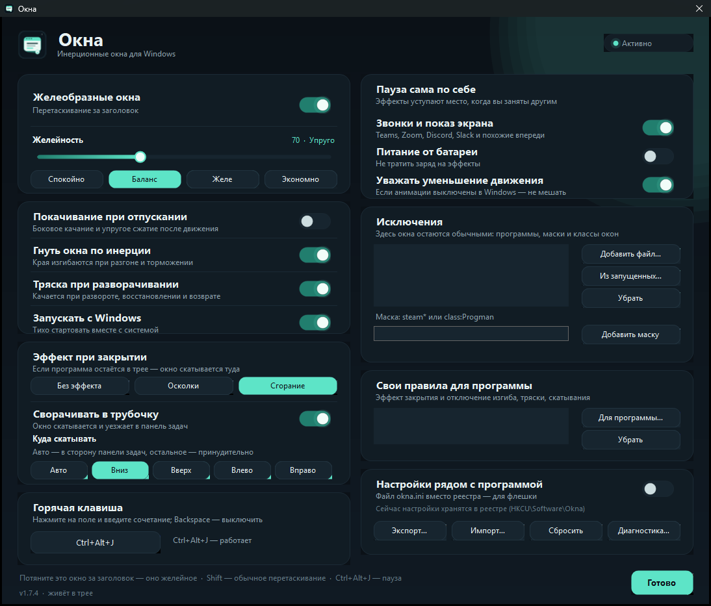

# Окна

Инерционные окна для Windows: при перетаскивании за заголовок окно отстаёт,
изгибается по инерции и мягко догоняет курсор. Содержимое остаётся живым —
видео играет, проводник обновляется, браузер рисует страницу.



## Что умеет

- **Изгиб по инерции.** Края окна изгибаются при разгоне и торможении, как
  будто окно сделано из желе. Без пружин и раскачки — только честная
  деформация от ускорения.
- **Живое содержимое.** Копия окна обновляется 30–60 раз в секунду, поэтому
  видео, анимации и списки файлов не замирают во время перетаскивания.
- **Покачивание при отпускании** (по желанию): короткое боковое качание после
  остановки.
- **Желейное покачивание.** Окно колышется, когда разворачивается на весь
  экран, когда снова становится обычным и когда возвращается из панели задач:
  копия окна изгибается и оседает, как желе, а не дёргается целиком.
  Покачивание начинается сразу, как только окно встало на новое место — в том
  числе у программ, которые «разворачиваются» сами, меняя свой размер
  (Chrome, Electron, OpenCode).
- **Разбивание при закрытии.** Когда окно закрывают кнопкой (или по Alt+F4),
  оно рассыпается на осколки, которые разлетаются от кнопки закрытия,
  кувыркаются, падают и тают.
- **Сгорание при закрытии.** Вместо осколков окно можно сжигать: снизу вверх
  ползёт неровная кромка огня, над ней буреет и обугливается бумага, вверх
  летят искры и дым. Сгоревшая часть исчезает, открывая рабочий стол. Эффект
  закрытия выбирается в настройках: без эффекта, осколки или сгорание.
- **Автопауза.** Окна откладывают эффекты сами, когда это неуместно: в полноэкранном
  приложении (игре или видео), при звонке или показе экрана (Teams, Zoom, Discord,
  Slack и похожие), при сеансе удалённого рабочего стола, при питании от батареи
  и когда в Windows выключены анимации. Пауза временная, она снимается сама, а
  выключить эффекты можно и самим.
- **Исключения.** Некоторые программы (игры, редактор, терминал) можно вынести из
  эффектов — тогда их окна переносятся обычным Windows-поведением. Исключение
  задаётся именем файла, маской (`steam*`) или классом окна (`class:Progman`).
- **Горячая клавиша.** Любое сочетание с модификатором (по умолчанию `Ctrl+Alt+J`)
  мгновенно включает или выключает эффекты; если клавиша занята другой программой,
  Окна скажут об этом, а не промолчат.
- **Настройки — тоже желе.** Окно настроек само участвует в эффекте: при первом
  показе оно мягко колышется, а потянуть его за заголовок можно прямо во время
  подбора желейности, чтобы сразу почувствовать результат.
- **Сворачивание в трубочку.** При сворачивании окно скатывается в бумажную
  трубочку — вниз, вверх, влево, вправо или автоматически к панели задач, — и
  уезжает в её настоящую кнопку: с кнопки окна, из панели задач или по Win+Down.
- **Эффект для отдельной программы.** Для одной программы можно выбрать свой
  эффект закрытия (осколки, сгорание или ничего), не меняя общий.
- **Экономно.** Режим без живой копии экрана и без тряски — для слабых машин и
  работы от батареи.
- **Настройки рядом с программой.** Если положить `okna.ini` рядом с `Okna.exe`,
  настройки будут храниться там, а не в реестре. Экспорт, импорт и сброс — в
  настройках.
- **Shift** при перетаскивании — обычное поведение Windows, включая Aero Snap.
- **Трей.** Программа живёт в трее и не мешает: левый клик — настройки,
  правый — меню со статусом, быстрыми переключателями, паузой на 30 минут,
  журналом и диагностикой. Значок меняется, когда эффекты на паузе или окно
  исключено.
- **Автозапуск** вместе с Windows. Запуск второй копии не перехватывает
  автозапуск установленной.
- **Автообновление** из GitHub Releases. Если новая версия не запустится,
  предыдущая вернётся сама.

## Установка

1. Скачайте `Okna.exe` со страницы [Releases](../../releases/latest).
2. Положите в любую папку и запустите.
3. Окно настроек появится при первом запуске. Дальше программа живёт в трее.

Папку лучше выбрать ту, куда у вас есть права записи (рабочий стол, документы,
`%LOCALAPPDATA%`). В `Program Files` автообновление не сможет заменить файл.

Требования: Windows 8.1, 10 или 11 (64-бит), .NET Framework 4.8. В Windows 10
и 11 он уже установлен; на 8.1 его нужно поставить один раз. В Windows 8.1 и в
Windows 10 до версии 1803 нет Windows Graphics Capture, поэтому проводник при
перетаскивании показывает замороженную копию содержимого — остальные эффекты
работают полностью. Права администратора не нужны.

Программа раньше называлась «Желе-окна». При первом запуске настройки
переносятся автоматически, старую версию можно удалить.

## Настройки

| Параметр | Что делает |
| --- | --- |
| Желеобразные окна | включает и выключает эффект целиком |
| Желейность | 0–200: насколько сильно окно отстаёт, изгибается и качается; 70 — как раньше, 200 — максимально вязко |
| Спокойно / Баланс / Желе / Экономно | готовые наборы (18 / 70 / 130); «Желе» включает покачивание, «Экономно» выключает живую копию и тряску |
| Покачивание при отпускании | боковое качание и упругое сжатие после движения |
| Гнуть окна по инерции | настоящая деформация краёв |
| Тряска при разворачивании | желейное покачивание при развороте, восстановлении и возврате из панели задач |
| Эффект при закрытии | без эффекта, осколки или сгорание — на выбор |
| Эффект для отдельной программы | свой эффект закрытия для одной программы или маски (`steam*`) |
| Сворачивать в трубочку | при сворачивании окно скатывается и уезжает в панель задач |
| Куда скатывать | авто (к панели задач), вниз, вверх, влево, вправо |
| Запускать с Windows | тихий старт вместе с системой |
| Звонки и показ экрана | пауза, когда впереди Teams, Zoom, Discord, Slack и похожие |
| Питание от батареи | не тратить заряд на эффекты |
| Уважать уменьшение движения | не мешать, если анимации выключены в Windows |
| Горячая клавиша | любое сочетание с модификатором; Backspace — выключить |
| Исключения | программы, маски (`steam*`) и классы окон (`class:Progman`) |
| Настройки рядом с программой | хранить настройки в `okna.ini` вместо реестра |
| Экспорт / Импорт / Сбросить | перенести настройки на другую машину или вернуть заводские |
| Диагностика | отчёт о версии, системе, настройках, экранах и хвосте журнала |

Настройки хранятся в `HKEY_CURRENT_USER\Software\Okna`, журнал — в
`%LOCALAPPDATA%\Okna\okna.log`. Если рядом с `Okna.exe` лежит `okna.ini`,
настройки читаются и пишутся туда.

## Что нового в v1.7.1

- **Наборы снова включают эффект.** После «Экономно» выбор «Желе» оставлял
  выключенными изгиб и тряску, поэтому окно становилось неподвижным, хотя
  ползунок показывал «Максимально вязко». Теперь каждый набор задаёт и
  переключатели: «Спокойно» и «Баланс» — изгиб и тряску, «Желе» — ещё и
  покачивание, «Экономно» — выключает дорогие эффекты.
- **Ползунок выходит из «Экономно».** Если после «Экономно» потянуть ползунок,
  набор снимается, живая копия и изгиб возвращаются, а значение остаётся
  выбранным — окно больше не выглядит статичным на максимуме.

## Что нового в v1.7.0

- **Настройки в ширину.** Окно настроек больше не длинная колонка: две колонки,
  шапка с логотипом и статусом, нижняя строка с подсказкой и кнопками. На
  маленьком экране окно ужимается по рабочей области и прокручивается, а не
  обрезается.
- **Желе можно попробовать на самих настройках.** Встроенное окно-заглушка и
  кнопки «Показать…» убраны. Вместо них окно настроек само стало целью эффекта:
  при первом показе за запуск оно мягко колышется, а за заголовок его можно
  потянуть и отпустить, чтобы увидеть изгиб и покачивание вживую.
- **Желейность до 200.** Ползунок расширен с 0–100 до 0–200: верхняя половина
  делает окна заметно вязче — сильнее изгиб, размах покачивания и качание после
  отпускания. Значение по умолчанию осталось 70 и ощущается как раньше, наборы
  теперь 18 / 70 / 130.
- **Мелочи.** Подпись ползунка показывает и число, и словами («200 · Максимально
  вязко»); подсказка внизу напоминает, что окно настроек можно потянуть, а Shift
  даёт обычное перетаскивание.

## Что нового в v1.6.0

- **Направление трубочки.** Четыре направления и «Авто»: трубочка летит к той
  стороне, где стоит панель задач, и попадает в настоящую кнопку окна (через
  UI Automation), а не в пустое место под центром окна. Верхняя и левая панели
  задач тоже учитываются.
- **Исключения из запущенных окон.** Кнопка «Из запущенных…» показывает открытые
  окна; можно добавить программу или её класс. Маски (`steam*`, `class:Progman`)
  вводятся вручную.
- **Автопауза стала умнее.** Звонки и показ экрана, питание от батареи и
  выключенные в Windows анимации тоже ставят эффекты на паузу.
- **Меню трея.** Статус, быстрые переключатели, пауза на 30 минут, открытие
  журнала и диагностика. Значок меняется, когда эффекты на паузе или окно
  исключено.
- **Своя горячая клавиша.** Любое сочетание с модификатором; занятую клавишу
  программа называет вслух.
- **Эффект для отдельной программы.** Общий эффект закрытия остаётся, а для
  выбранной программы можно задать свой.
- **Экономно.** Набор без живой копии экрана и без тряски.
- **Настройки рядом с программой.** `okna.ini` для флешки, экспорт, импорт и
  сброс настроек.
- **Диагностика.** Одна кнопка собирает версию, систему, настройки, экраны,
  панели задач и хвост журнала — можно скопировать или сохранить.
- **Надёжное обновление.** Старая версия после перезапуска ждёт сигнала от
  новой; если та не запустилась, старая возвращается сама.
- **Мелочи.** Автозапуск больше не перехватывается запущенной копией; картинка
  для трубочки не переснимается, пока курсор стоит на кнопке сворачивания;
  ожидание «программа спряталась в трей» увеличено с 0,18 до 0,5 секунды, чтобы
  успевали медленные программы; уважается уменьшение движения Windows.

## Что нового в v1.5.1

- **Направление трубочки.** Сворачивание и уход в трей можно скатывать не
  только сверху вниз, но и сбоку: окно собирается справа налево в
  вертикальный валик и уезжает боком. Переключатель «Скатывать сбоку» — в
  настройках.

## Что нового в v1.5.0

- **Автопауза.** Эффекты (разгиб, покачивание, тряска, закрытие) откладываются
  автоматически в полноэкранных приложениях, при сеансе удалённого рабочего
  стола и в режиме экономии энергии. Пауза временная: эффекты возвращаются сами.
- **Исключения.** Можно вынести отдельные программы из эффектов — у их окон не
  будет ни изгиба, ни закрытия, ни сворачивания. Через «Добавить…» в настройках
  или из реестра `HKEY_CURRENT_USER\Software\Okna` (значение `Exclude`).
- **Горячая клавиша `Ctrl+Alt+J`.** Мгновенно включает или выключает эффекты —
  глобально, даже когда окно настроек закрыто.
- **Предпросмотр.** Кнопки «Показать осколки / сгорание / трубочку» в окне
  настроек проигрывают эффект на встроенном окне-заглушке.

## Как это работает

Windows не позволяет по-настоящему изогнуть чужое окно, поэтому во время
перетаскивания поверх него показывается прозрачный слой с изогнутой копией
содержимого. Слой получает кадры окна через Windows Graphics Capture
(проводник) или `PrintWindow` (Chrome, Electron, обычные программы) и рисует
их с волновой деформацией. Настоящее окно на это время скрывается на месте,
а после отпускания возвращается уже в новой позиции.

Изгиб считается по ускорению курсора: пока окно разгоняется, оно отстаёт и
выгибается назад, при торможении — догоняет и выгибается вперёд. Никаких
затухающих колебаний в самой деформации нет.

Развёрнутым окно считается не только когда система говорит, что оно развёрнуто:
программы на Electron и Chrome «разворачиваются» сами, просто растягиваясь на
рабочий стол, и система при этом считает их обычными. Поэтому окно, чей размер
совпал с рабочим столом, тоже считается развёрнутым.

Тряска при разворачивании — тоже не настоящая: окно на полторы секунды
подменяется своей копией, которая изгибается и оседает, как желе. Настоящее
окно при этом не двигается, поэтому развёрнутое окно остаётся развёрнутым, а
обычное — стоит ровно там, где стояло. Копия снимается, когда картинка на
экране перестала меняться: система доиграла анимацию, а программа
перерисовалась в новом размере. Обычно это 0,06–0,25 секунды после щелчка,
поэтому покачивание видно сразу. Если окно ничем не перекрыто, копия берётся
прямо с экрана — тогда в ней точно есть фон и полупрозрачные панели;
перекрытое окно снимается через `PrintWindow`. Окно, которое не отрисовалось
за 0,15 секунды (так ведёт себя, например, «Блокнот» Windows 11) или
продолжает меняться дольше 0,7 секунды, остаётся со своей собственной
анимацией: запоздалое покачивание выглядело бы как сбой. Если копию снять не
удалось совсем, программа откатывается к прежней честной тряске сдвигом.

Разбивание при закрытии работает так: когда курсор попадает на кнопку закрытия
(или зажаты Alt+F4), программа запоминает картинку окна. Если окно после этого
исчезает, картинка режется на осколки по сетке со смещёнными углами, и они
разлетаются от точки удара, кувыркаются, падают под тяжестью и растворяются.
Каждый осколок — отдельный кусок настоящей картинки окна с белой кромкой.
Закрытие через меню панели задач так не отслеживается: картинку нужно снять
до того, как окно исчезнет.

Сгорание устроено похоже: снятая картинка окна остаётся на экране, а по ней
снизу вверх идёт неровная кромка огня. Над кромкой картинка темнеет и
обугливается, сама кромка светится и дышит, от неё поднимаются языки пламени,
искры и дым. Высота пламени и скорость зависят от высоты окна, поэтому
большое окно горит дольше маленького. Если программа прячется в трей, огня
нет — окно, как и при осколках, скатывается в трубочку и уезжает к значку.

Если программа при закрытии не завершается, а прячется в трей (Telegram, Steam,
Discord и им подобные), окно не рассыпается: ничего не закрылось. Вместо этого
его картинка скатывается в трубочку (в выбранную сторону) и по дуге уезжает в
область уведомлений, уменьшаясь до размера значка. Программа ждёт полсекунды:
если окно за это время всё-таки уничтожилось, значит, оно закрылось
по-настоящему, и летят осколки; если осталось скрытым — трубочка. Отключается
вместе с эффектом закрытия.

Сворачивание в трубочку: пока окно ещё на экране, программа запоминает его
картинку — когда курсор наводится на кнопку сворачивания, нажимается кнопка в
панели задач или зажаты Win / Alt+Space. В момент сворачивания картинка
скатывается в трубочку: оставшаяся часть стоит как была, а свернувшаяся уходит
в валик с бликом и тенью. По умолчанию валик собирается сверху вниз; можно
выбрать вверх, влево, вправо или «Авто» — тогда направление берётся от края, у
которого стоит панель задач. Затем трубочка по дуге уезжает в настоящую кнопку
окна на панели задач (её положение находит UI Automation, а если не вышло —
геометрия панели), уменьшается до размера кнопки и тает. Системная анимация
сворачивания на этот момент отключается, чтобы не летела вторая копия окна.
Если окно вернуть из панели задач, пока трубочка ещё летит, анимация сразу
прекращается и окно остаётся на месте.

## Сборка

Нужен только .NET Framework 4.x (компилятор `csc.exe` уже есть в Windows):

```powershell
.\build.ps1
.\test.ps1
```

`build.ps1` собирает `dist\Okna.exe`, `test.ps1` — headless-проверки
(`dist\OknaTests.exe`): направление и геометрия трубочки, попадание в панель
задач, маски исключений, эффекты для программ, автозапуск и перенос настроек
через `okna.ini`. Оба скрипта запускаются в GitHub Actions на каждый коммит.

Релиз собирается автоматически по тегу: запушьте тег вида `vX.Y.Z` — GitHub
Actions соберёт exe, посчитает SHA-256 и опубликует релиз.

## Проверка на разных экранах

Чек-лист для нескольких мониторов, смешанного DPI и Windows 8.1 — в
[TESTING.md](TESTING.md).

## Автообновление

Программа проверяет
`https://api.github.com/repos/Sergey35853/okna/releases/latest` при запуске и
раз в 6 часов. Новая версия скачивается в фоне, сверяется с
SHA-256 из релиза и устанавливается сама: старый exe переименовывается,
новый занимает его место, программа перезапускается. Если вы в этот момент
перетаскиваете окно или открыты настройки, обновление ждёт удобного момента.

Автообновление можно выключить в меню трея.

## Лицензия

MIT — см. [LICENSE](LICENSE).
